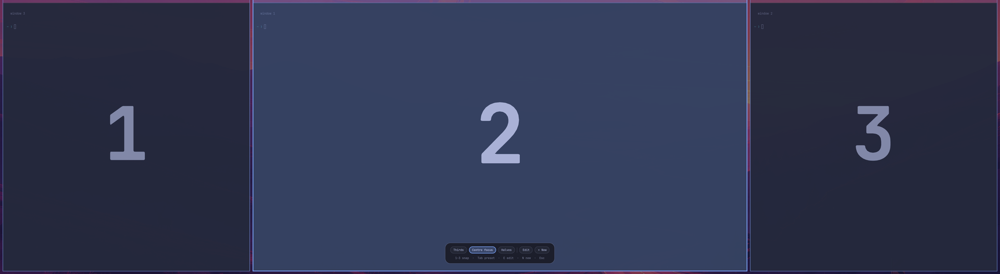
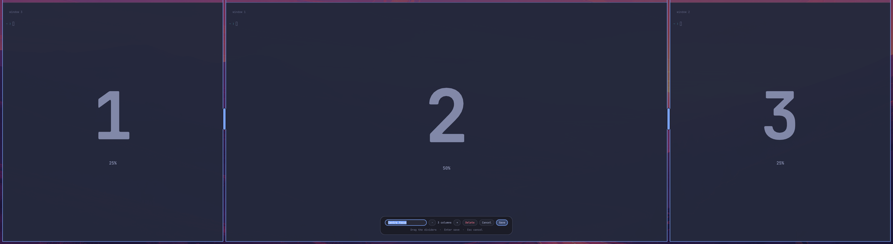
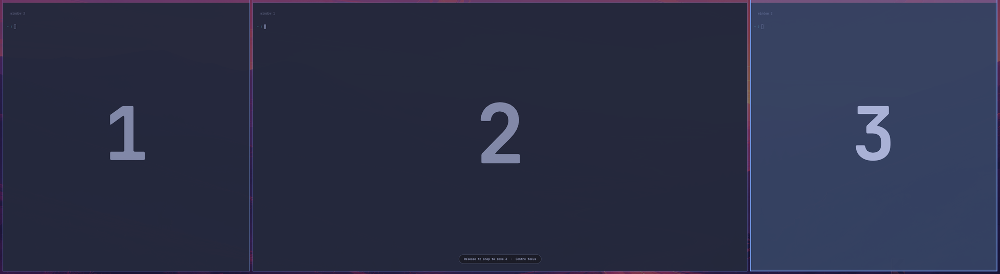
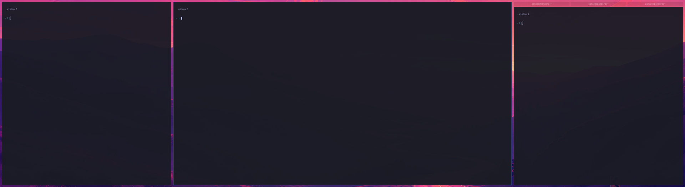

# lanesnap

Zone-based window snapping for [Omarchy](https://omarchy.org/) (Hyprland), built for ultrawide monitors.
Define layouts as rows of columns ("zones"), snap windows into them with a keyboard shortcut, an
overlay, or by dragging, and keep everything **tiled**: other windows rearrange around the one you
placed instead of floating over it.

It is similar in spirit to Windows PowerToys' zone layouts, but built on Hyprland's scrolling
layout, so windows stay tiled and swap places instead of overlapping.

- **Overlay and editor** (`SUPER+Z`): shows the current layout over the screen at the real window
  positions. Click a zone or press its number to snap. `Tab` switches presets; `E` edits one and `N`
  makes a new one (2 to 9 columns, drag the dividers, name it, save).
- **Number keys** (`CTRL+ALT+1..9`): snap the focused window into zone N of the selected preset.
- **Drag to a zone** (`SUPER+SHIFT` + drag): hold, press the left button on a window, move over a zone, release.
- **Swap, don't overlap**: moving a window into an occupied zone swaps the two.
- **Overflow becomes tabs**: more windows than zones? The extras join the last zone as a tab group
  (Hyprland window groups) instead of being squeezed or hidden.
- **Fewer windows than zones**: the columns that exist take the widest zones; a lone window is centred.

Default presets: Thirds, Centre focus (25/50/25), Halves, Wide centre (20/60/20).

## Screenshots

On a 3840×1080 ultrawide, with the Centre focus preset.

**Overlay (`SUPER+Z`)** shows the zones where windows will land. Click a zone or press its number; `Tab` switches presets.



**Editor (`E` or `+ New`)**: name the preset, add or remove columns, drag the dividers.



**Drag to a zone (`SUPER+SHIFT` + drag)**: the zone under the cursor lights up; release to snap.



**Overflow becomes tabs**: five windows in three zones, so the last zone holds three as a tab group.



## Requirements

- Omarchy 4 (the zone overlay is an Omarchy shell / Quickshell plugin, and the bindings use Omarchy's `o.bind`)
- Hyprland 0.56 or newer (Lua config, scrolling layout)
- `jq`, `hyprctl`, `omarchy-shell` on `PATH`

## Install

```bash
git clone https://github.com/patricksnape/lanesnap ~/git/lanesnap
cd ~/git/lanesnap
make install    # symlinks scripts, adds one require() line to ~/.config/hypr/bindings.lua, enables the plugin
make doctor     # checks everything is in place
```

`make install` symlinks, it does not copy, so `git pull` updates everything. It never overwrites
your layouts (`~/.config/lanesnap/layouts.json`). `make uninstall` removes it and keeps your layouts.

## Keys

| Keys | Action |
| --- | --- |
| `SUPER+Z` | zone overlay: click or press a number to snap; `Tab` switch preset; `E` edit; `N` new; `Esc` close |
| `CTRL+ALT+1..9` | snap the focused window into zone N of the selected preset (nothing if it has no zone N) |
| `SUPER+SHIFT` + left-drag | drag-to-zone: hold, press on a window, move over a zone, release (release outside to cancel) |
| `SUPER+SHIFT+Z` | flip the current workspace between scrolling (lanesnap) and dwindle |
| `SUPER+J` | scrolling: stack the window under its neighbour in a column / pull it out. dwindle: toggle split |

All are listed in Omarchy's keybinding help (`SUPER+K`). To change them, edit `hypr/lanesnap.lua`
or override in your own `bindings.lua` after the `require` line (use `hl.unbind` first).

Tabs (window groups) use Omarchy's own keys: `SUPER+ALT+TAB` / `SUPER+CTRL+←/→` to switch,
`SUPER+ALT+G` to take a window out.

## Layouts

`~/.config/lanesnap/layouts.json`, edited by the overlay or by hand:

```json
{
  "layouts": { "focus": { "label": "Centre focus", "zones": [[0, 0, 1, 4], [1, 0, 2, 4], [3, 0, 1, 4]] } },
  "order": ["focus"],
  "default": "focus"
}
```

A zone is `[col, row, colspan, cols]`; its width is `colspan / cols` of the usable screen. Zones
are columns, left to right. `default` is the preset the number keys use: it is whichever you last
selected or snapped with in the overlay.

## How it works

Each layout of N zones becomes N columns in Hyprland's scrolling layout, sized to the zone widths
with `colresize`. Placing a window swaps columns (`swapcol`) until it is in its zone; extras beyond N
columns are folded into the last column as a window group. The overlay is a Quickshell panel; drag
mode is a press/release mouse binding that polls the cursor position, with no compositor plugin and
no compiled code.

## Updates and compatibility

Hyprland's Lua API and Omarchy's shell-plugin format are young and still changing.

- Every Hyprland dispatcher string is in `lib/hypr.sh`, so an API change is a one-file fix.
- `make doctor` checks versions, bindings and the plugin; `make test` runs the real thing on throwaway
  terminals on a scratch workspace (set `LANESNAP_TEST_WS` to an empty workspace; foot is the default terminal).
- Two GitHub Actions jobs run daily:
  - `hyprland-compat` loads `hypr/lanesnap.lua` and builds every dispatcher `lib/hypr.sh` uses against the
    **latest Hyprland on Arch**, using `Hyprland --verify-config` (no compositor needed). It is quick and catches
    removed or renamed dispatchers and some argument changes, but not layout-message or behaviour changes.
  - `vm-test` boots a NixOS VM with a virtual GPU, starts a real Hyprland and runs `tests/smoke.sh` against it
    (the same approach Hyprland's own CI uses, since Hyprland cannot run without a DRM device). It tests the
    Hyprland in **nixpkgs**, which tracks upstream releases. Run it yourself with
    `nix build .#checks.x86_64-linux.vm -L` (needs KVM).
  - Either job opens an issue when the daily run fails.
- Layouts and your own bindings live outside the repo and are never overwritten.

| lanesnap | Hyprland | Omarchy | Status |
| --- | --- | --- | --- |
| 0.1.x | 0.56.2 | 4 | tested end to end (`make test`, daily use) |
| 0.1.x | 0.57.0 | not tested | smoke test passes on a real Hyprland in the NixOS VM (`vm-test`); not tried on a live Omarchy system |

## Limitations

- Hyprland reloads its config whenever a file in `~/.config/hypr/` changes, which drops a workspace's
  layout back to dwindle. The next snap puts it back.
- A column exists only while it holds a window, so you can't reserve an empty zone. A window can't be
  pinned to a side that has no window.
- New windows open as their own column; the next snap folds extras into tabs.
- Drag mode shows the zone highlight but the window does not follow the cursor. The 20-second safety
  timeout dismisses the overlay if the release is missed (for example if you let go of the modifiers first);
  `lanesnap-drag cancel` dismisses it immediately.

## Development

`make lint` (bash syntax, JSON, shellcheck if installed), `make doctor`, `make test` (live session), `nix build .#checks.x86_64-linux.vm -L` (NixOS VM, needs KVM).

## Licence

MIT, see `LICENSE`. The drag-snap approach was informed by reading
[omarchy-windows](https://github.com/jwm3000/omarchy-windows) (MIT), a different design that floats windows
using a native Hyprland plugin; no code was copied from it.
